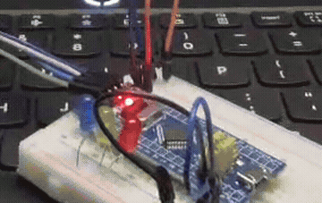

# 电控组第二次培训作业

- **王康悦**
- ***20263008220***

基于 **STM32F103C8T6** 最小系统板，用 **STM32CubeMX + CLion + HAL 库** 实现三颗 LED 间隔 500ms 的流水灯，并使用 **User Label** 功能把三个引脚分别命名为 `LED0` / `LED1` / `LED2`，代码中直接调用对应的宏定义。

---

## 一、开发环境

| 项目 | 版本 |
| --- | --- |
| 芯片 | STM32F103C8T6（Cortex-M3，64KB Flash / 20KB RAM） |
| 配置工具 | STM32CubeMX 6.15.0 |
| IDE | CLion 2026.2.2 |
| 工具链 | arm-none-eabi-gcc 10.3.1 + CMake + Ninja |
| 下载器 | ST-Link V2（OpenOCD 0.12.0 驱动） |
| 库 | STM32Cube FW_F1 HAL 库 |

## 二、硬件连接

三颗 LED 全部采用**共阳极**接法，即 LED 长脚（正极）经限流电阻接板上 3.3V，短脚（负极）接 GPIO，**低电平点亮、高电平熄灭**。

| 名字 | 引脚 | 限流电阻 | 接法 |
| --- | --- | --- | --- |
| `LED0` | PA0 | 100~220Ω | 3.3V → 电阻 → LED长脚 → LED短脚 → PA0 |
| `LED1` | PA2 | 100~220Ω | 3.3V → 电阻 → LED长脚 → LED短脚 → PA2 |
| `LED2` | PA3 | 100~220Ω | 3.3V → 电阻 → LED长脚 → LED短脚 → PA3 |

> 引脚选择避开了 `PA13/PA14`（SWD 调试口）和 `PA15/PB3/PB4`（JTAG 复用脚），避免配置成普通输出后无法再次烧录。

## 三、CubeMX 配置要点

1. **RCC**：HSE 外部晶振，PLL ×9，系统时钟 **72MHz**
2. **SYS**：Debug = Serial Wire（保留 SWD 下载口）
3. **GPIO**：PA0、PA2、PA3 均配置为 `GPIO_Output`
   - GPIO output level：`High`（上电即为高电平，三灯全灭）
   - GPIO mode：`Output Push Pull`（推挽输出）
   - GPIO Pull-up/Pull-down：`No pull-up and no pull-down`
   - Maximum output speed：`Low`
   - **User Label：`LED0` / `LED1` / `LED2`**

生成代码后，CubeMX 会自动在 `Core/Inc/main.h` 中生成如下宏定义：

```c
/* Private defines -----------------------------------------------------------*/
#define LED0_Pin GPIO_PIN_0
#define LED0_GPIO_Port GPIOA
#define LED1_Pin GPIO_PIN_2
#define LED1_GPIO_Port GPIOA
#define LED2_Pin GPIO_PIN_3
#define LED2_GPIO_Port GPIOA
```

后续代码全部通过这几个宏访问引脚，不直接写 `GPIOA, GPIO_PIN_0`。

## 四、实现思路

流水灯的本质是**三个状态按固定顺序循环**，每个状态只点亮一颗灯、另外两颗熄灭：

```
状态 1：LED0 亮、LED1 灭、LED2 灭   → 保持 500ms
状态 2：LED0 灭、LED1 亮、LED2 灭   → 保持 500ms
状态 3：LED0 灭、LED1 灭、LED2 亮   → 保持 500ms
                 ↑ 回到状态 1 循环
```

由于是共阳极低电平点亮，写的时候要记住：**`GPIO_PIN_RESET` = 亮，`GPIO_PIN_SET` = 灭**。

程序分两处写用户代码，都放在 CubeMX 的 `USER CODE` 保护区内，重新生成代码不会被覆盖：

**① 上电初始化（`USER CODE BEGIN 2`）**：先把三颗灯全部熄灭，避免上电瞬间三灯同时亮。

```c
/* 三颗灯都是低电平点亮：SET = 灭，RESET = 亮。上电先全部熄灭 */
HAL_GPIO_WritePin(LED0_GPIO_Port, LED0_Pin, GPIO_PIN_SET);
HAL_GPIO_WritePin(LED1_GPIO_Port, LED1_Pin, GPIO_PIN_SET);
HAL_GPIO_WritePin(LED2_GPIO_Port, LED2_Pin, GPIO_PIN_SET);
```

**② 主循环（`USER CODE BEGIN 3`）**：三个状态依次执行，每个状态后用 `HAL_Delay(500)` 停留 500ms。

```c
while (1)
{
    /* 第 1 颗亮，另外两颗灭 */
    HAL_GPIO_WritePin(LED0_GPIO_Port, LED0_Pin, GPIO_PIN_RESET);
    HAL_GPIO_WritePin(LED1_GPIO_Port, LED1_Pin, GPIO_PIN_SET);
    HAL_GPIO_WritePin(LED2_GPIO_Port, LED2_Pin, GPIO_PIN_SET);
    HAL_Delay(500);

    /* 第 2 颗亮，另外两颗灭 */
    HAL_GPIO_WritePin(LED0_GPIO_Port, LED0_Pin, GPIO_PIN_SET);
    HAL_GPIO_WritePin(LED1_GPIO_Port, LED1_Pin, GPIO_PIN_RESET);
    HAL_GPIO_WritePin(LED2_GPIO_Port, LED2_Pin, GPIO_PIN_SET);
    HAL_Delay(500);

    /* 第 3 颗亮，另外两颗灭 */
    HAL_GPIO_WritePin(LED0_GPIO_Port, LED0_Pin, GPIO_PIN_SET);
    HAL_GPIO_WritePin(LED1_GPIO_Port, LED1_Pin, GPIO_PIN_SET);
    HAL_GPIO_WritePin(LED2_GPIO_Port, LED2_Pin, GPIO_PIN_RESET);
    HAL_Delay(500);
}
```

## 五、编译与烧录

编译结果（CLion / CMake + Ninja）：

```
[100%] Built target led-0.elf

RAM:    2656 B / 20 KB   (12.97%)
FLASH:  4964 B / 64 KB   (7.57%)
```

烧录日志（OpenOCD + ST-Link）：

```
Info : STLINK V2J37S7 (API v2) VID:PID 0483:3748
Info : Target voltage: 3.224
Info : device id = 0x00006410
Info : flash size = 64 KiB
** Programming Started **
** Programming Finished **
** Verified OK **
** Resetting Target **
```

## 六、验收演示



> 上图为从完整验收视频中截取的 7.5s~18s 片段（板子特写），完整过程请见下方视频。

完整演示视频见仓库根目录 **`demo.mp4`**（未剪辑，一次录完，19 秒 / 5.1MB），内容依次为：

1. CLion 中 Rebuild，输出 `[100%] Built target led-0.elf`
2. 点击 Run，OpenOCD 连接 ST-Link 并烧录
3. 日志出现 `** Programming Started **` / `** Programming Finished **`
4. 开发板上三颗 LED 以 500ms 间隔轮流点亮

烧录成功的 Run 窗口日志截图见 **`run-log.png`**。

**关于观看视频**：GitHub 的文件页面不提供在线播放器，点开 `demo.mp4` 只会看到 Download 按钮，
这是平台行为，不是文件损坏。请点 **Download**（或 **Raw**）下载到本地后用播放器打开；
若下载缓慢，多为 `raw.githubusercontent.com` 在国内访问受限所致，可换网络重试。

## 七、目录结构

```
.
├── Core/
│   ├── Inc/                      # main.h（含 LED0/1/2 宏定义）、gpio.h 等
│   ├── Src/                      # main.c（流水灯逻辑）、gpio.c、中断与外设初始化
│   └── Startup/                  # 启动文件 startup_stm32f103c8tx.s
├── Drivers/                      # STM32F1 HAL 库 + CMSIS
├── CMakeLists.txt                # 工程构建脚本（含 arm-none-eabi 交叉编译配置）
├── STM32F103C8TX_FLASH.ld        # 链接脚本
├── led-0.ioc                     # CubeMX 工程文件（含 LED0/1/2 User Label）
├── demo.mp4                      # 验收演示视频（完整过程）
├── demo.gif                      # 流水灯动图（视频片段，README 中直接显示）
└── run-log.png                   # 烧录成功日志截图
```
